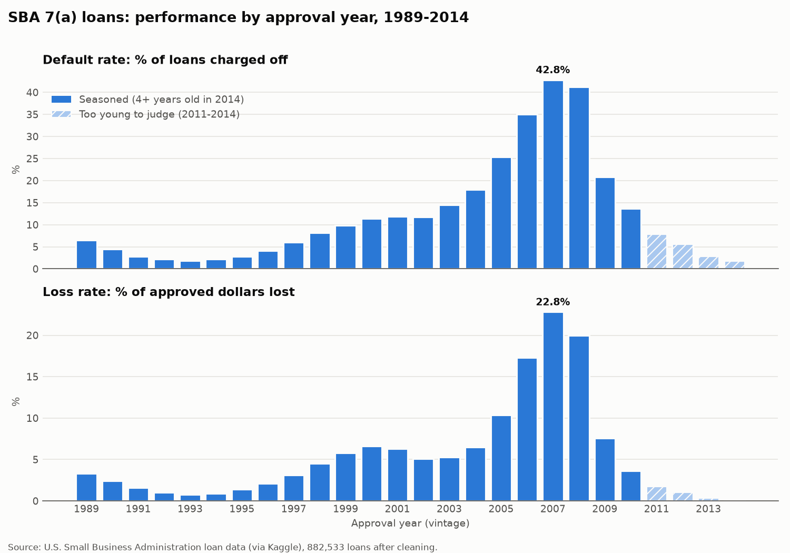
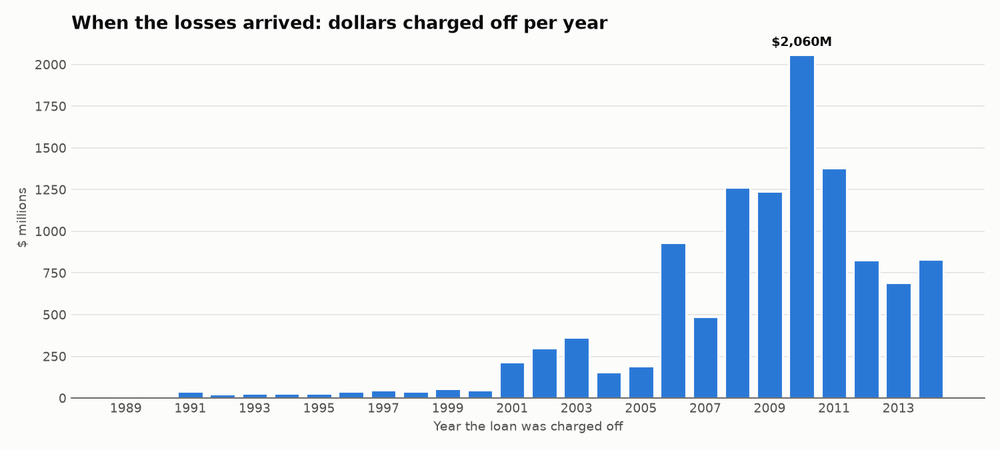
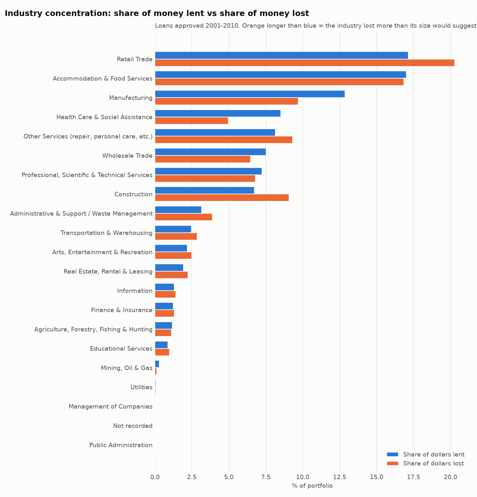
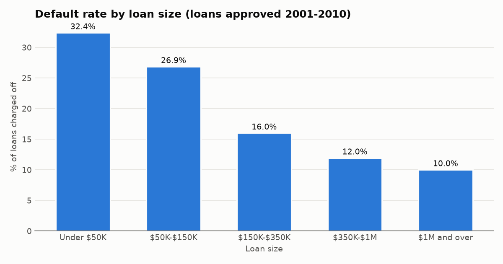
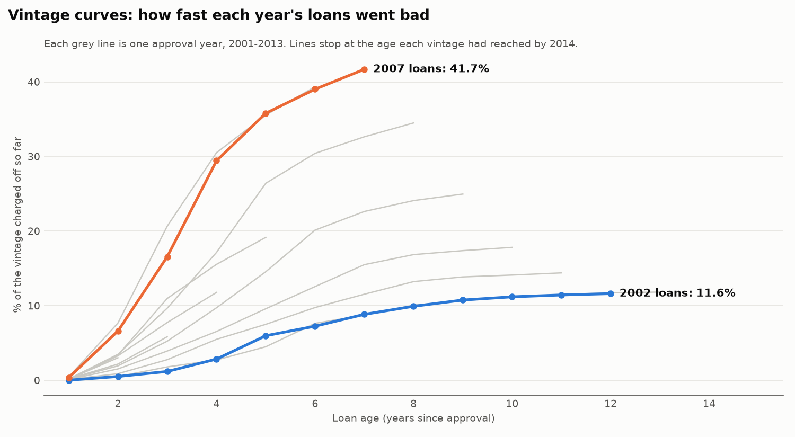
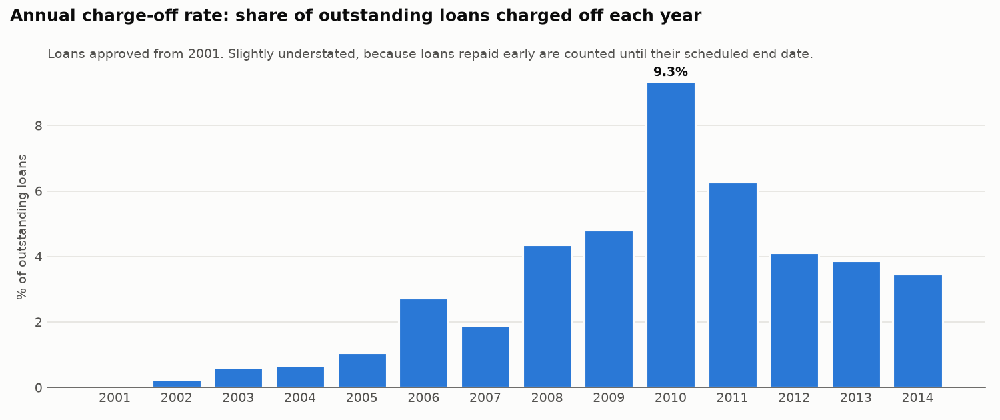

# Commercial Credit Portfolio Analysis (SBA 7(a) Loans)

**Author:** Bernard Frimpong
**Tools:** Python, SQL (DuckDB), Excel, Power BI / Tableau Public

## The question this project answers

> If I managed a commercial loan portfolio, where are the risks concentrated,
> how is the portfolio performing over time, and what should senior leaders watch?

I act as a **credit portfolio analyst** looking after a real portfolio of
U.S. small-business loans. These loans were made by banks and guaranteed by the
U.S. Small Business Administration (SBA). The data is free, public, and covers
about 900,000 real loans with their industry, state, lender, size,
and final outcome (paid back in full or charged off as a loss), including
the 2008 financial crisis.

## Data sources

| Source | What it gives us | Link |
|---|---|---|
| SBA national loan data (Kaggle) | ~900,000 SBA loans approved up to 2014: amount, industry (NAICS), state, lender, status, charge-off amount | https://www.kaggle.com/datasets/mirbektoktogaraev/should-this-loan-be-approved-or-denied |
| FRED (Federal Reserve Bank of St. Louis) | Economic indicators, e.g. unemployment rate | https://fred.stlouisfed.org/ |

## Roadmap (one step at a time)

Each step matches something the job postings ask for.

| Step | What we build | Job skill it proves |
|---|---|---|
| 1 | Load the loan data into a SQL database and take a first look | SQL, Python, working with large datasets |
| 2 | Data quality checks and cleaning | Attention to detail, data quality |
| 3 | Portfolio performance: default rates and loss rates by approval year ("vintage") | Portfolio performance measurement |
| 4 | Risk concentrations: by industry, state, and loan size, with limits | Concentration management, tolerances and limits |
| 5 | Status roll-forward: how each yearly group of loans moves from active to paid off or charged off over time | Credit migration–style analysis |
| 6 | Economic indicators and early warnings: unemployment vs. charge-offs, rising-risk industries | Economic indicators, early warning indicators, emerging risks |
| 7 | Peer benchmarking: compare lenders' loss rates against the whole portfolio | Peer benchmarking |
| 8 | Dashboard in Power BI or Tableau Public, plus an Excel limits workbook | Dashboards, Excel |
| 9 | 5-slide executive summary with recommendations | Presenting to senior leadership, PowerPoint |

## How to run it

See `GUIDE_STEP1.md` for setup and the first step.

## Project layout

```
credit-portfolio-analysis/
├── data/
│   ├── raw/          <- the SBA CSV files you download go here (not uploaded to GitHub)
│   └── loans.duckdb  <- the database our scripts build (not uploaded to GitHub)
├── scripts/          <- Python scripts, run in number order
├── sql/              <- SQL query files
├── outputs/          <- charts and tables we produce
└── README.md
```

## Findings

### Step 2: Data quality

Starting data: **899,164 loans** (FY1962–FY2014), $173.3B approved.

| Rule | Reason | Loans removed | Loans left |
|---|---|---:|---:|
| 1 | Approved before 1989 (too few loans to measure reliably) | 14,715 | 884,449 |
| 2 | No final status (can't tell if repaid or lost) | 1,916 | 882,533 |
| 3 | Loan amount missing, zero or negative | 0 | 882,533 |

**Kept 882,533 loans (98.2%), $170.2B approved, 17.07% charged off.**
Full log: [`outputs/data_quality_log.csv`](outputs/data_quality_log.csv)

What the checks found:
- **No duplicate loans**, and fewer than 0.2% of loans are missing a state or lender.
- **Industry codes are missing for about 55% of loans approved before 2001**, and almost none after. Industry analysis therefore uses loans from 2001 onwards.
- **Dates with 2-digit years** ("62") were read as 2062. These were all 1960s loans, removed by rule 1. 0 date problems remain after cleaning.
- **Odd but kept (flagged) loans:** 4,698 paid in full with a loss recorded, 792 with a 0-month term, 531 with a loss bigger than the approved amount, 236 charged off with a $0 loss. Together they are under 0.7% of loans; later steps check that they don't change the results.
- **Recent loans are too young to judge.** Loans approved 2011–2014 show charge-off rates of 1.9%–7.8%, because most had only 1–3 years to fail before the data was collected in 2014. They are labelled as unseasoned in the analysis rather than treated as safe.
- **First signal of risk timing:** loans approved in 2007 charged off at 42.7%, 3.7 times the 11.4% rate for 2000 loans. Step 3 investigates this.

### Step 3: Vintage analysis (performance by approval year)



**Headline: loans approved in 2005–2008 were 21% of the dollars lent but caused 54% of all losses.**

| Era (approval years) | Loans | Approved | Default rate | Loss rate | Dollars lost |
|---|---:|---:|---:|---:|---:|
| 1989–1999 | 316,302 | $70.7B | 4.9% | 2.6% | $1.84B |
| 2000–2004 (before the boom) | 245,171 | $50.3B | 14.1% | 6.0% | $3.00B |
| **2005–2008 (boom, then crisis)** | **263,821** | **$36.2B** | **35.2%** | **16.9%** | **$6.11B** |
| 2009–2010 (after the crisis) | 35,931 | $6.9B | 17.5% | 5.6% | $0.38B |
| 2011–2014 (too young to judge) | 21,308 | $6.0B | 6.6% | 1.5% | $0.09B |

Full table by year: [`outputs/vintage_performance.csv`](outputs/vintage_performance.csv)

Findings:
1. **Loans need about 8 years before they can be judged.** Among 1989–2005 loans, only 32.5% of charge-offs happened within 4 years of approval, 49.1% within 5 years, and 87.0% within 8 years. Vintages are therefore labelled *seasoned* (8+ years old in 2014), *partly seasoned* (4–7 years: rates are minimums and can still rise) or *too young to judge* (under 4 years).
2. **The worst vintages were made at the top of the boom.** 2007 loans defaulted at 42.8% and lost 22.8% of approved dollars, against 1.9% and 0.8% for 1993 loans. Because 2007–2008 are only partly seasoned, their true rates are likely even higher.
3. **Bad loans also got worse.** Loss severity (share of a defaulted loan's amount that was lost) rose from 42–44% for 1992–1994 vintages to 78% for 2007–2008, consistent with falling collateral values in the crisis.
4. **Defaulted loans were smaller than average.** For 2007, 42.8% of *loans* defaulted, but those loans held only about 29% of the *dollars* (loss rate 22.8% ÷ severity 77.6%). Smaller loans default more often, which Step 4 tests directly.
5. **Losses arrived about 5 years after the lending peak.** Lending peaked in 2005 (76,958 loans); dollars charged off peaked in 2010 ($2.06B). 2008–2011 together account for $5.94B, about half of all recorded charge-offs.



Checks and limitations:
- **Flagged loans don't change the result:** removing all 6,215 flagged loans moves the default rate from 17.07% to 17.02% and the loss rate from 6.71% to 6.59%.
- **Charge-off dates before 2001 look incomplete.** Only 3,587 charge-offs are dated 1989–2000, although 1990s vintages alone have about 15,500 defaults. Default *rates* (based on loan status) are unaffected; *timing* results (findings 1 and 5) lean on post-2001 records.

### Step 4: Risk concentrations and limits

Loans approved 2001–2010 (industry is recorded and loans are at least 4 years old): **507,571 loans, $84.2B**.

**Risk index** = share of dollars lost ÷ share of dollars lent. Above 1.0 means a group loses more than its size suggests.



**Limit monitor** (example limits set for this project: 15% per industry, 10% per state; 10% and 7.5% for groups with risk index above 1.25; "Watch" at 80% of limit). Full list of 72 groups: [`outputs/limit_monitor.csv`](outputs/limit_monitor.csv)

| Group | Share of dollars | Risk index | Limit | Headroom | Status |
|---|---:|---:|---:|---:|---|
| California | 19.9% | 0.84 | 10.0% | −9.9% | **Breach** |
| Retail Trade | 17.1% | 1.18 | 15.0% | −2.1% | **Breach** |
| Accommodation & Food Services | 17.0% | 0.99 | 15.0% | −2.0% | **Breach** |
| Manufacturing | 12.9% | 0.75 | 15.0% | +2.1% | Watch |
| Texas | 8.4% | 1.04 | 10.0% | +1.6% | Watch |

Findings:
1. **Two industries hold a third of the money.** Retail (17.1%) and Accommodation & Food Services (17.0%) together hold 34.1% of dollars lent. Both depend on consumer spending, so a downturn is likely to hit them at the same time.
2. **California is the largest single concentration** at 19.9% of dollars, about twice the example state limit. Its loans lost *less* than average (risk index 0.84), so the issue is size, not loan quality.
3. **Risk hot spots are smaller groups that lose more than their size:**
   - Construction: 6.7% of dollars but 9.1% of losses (risk index 1.35, loss rate 14.2%)
   - Florida: 5.5% of dollars but 8.8% of losses (risk index 1.59, default rate 36.0%)
   - Michigan (1.39), Georgia (1.30) and New York (1.27) also lose clearly more than their size.
   Florida is within its tightened 7.5% limit but has used 73% of it, so it is the next group to reach Watch.
4. **Safer groups:** Health Care (risk index 0.58: 8.5% of dollars, 5.0% of losses), Manufacturing (0.75), Minnesota (0.75) and Washington (0.72).
5. **Small loans are much riskier.** Loans under $50K are 41.4% of loans but only 5.4% of dollars. They default at 32.4%, 3.2 times the 10.0% rate for loans of $1M and over, and lose 26.4% of their dollars (risk index about 2.5). This confirms the Step 3 finding that defaulted loans were smaller than average.



6. **Overall concentration (HHI):** industry 1,073 (*moderately concentrated*, as spread out as 9.3 equal industries), state 644 and lender 108 (*not concentrated*). The largest lender holds only 4.9% of dollars.
7. **Lender results mostly reflect loan size.** Bank of America has the highest risk index among the 10 largest lenders (2.58), but its average loan is about $43K, against about $168K at Wells Fargo. Comparing lenders fairly means comparing like-for-like loans, which Step 7 (peer benchmarking) does.

Limitations:
- Groups with very few loans give unreliable rates. Public Administration (81 loans) and "Not recorded" (68 loans) show high risk indexes that should be ignored.
- The 2001–2010 window includes the crisis vintages. Groups that lent more in 2005–2008 will look riskier partly because of *when* they lent, not only *what* they lent. Step 6 separates the two.
- The limits are example settings, not SBA or bank policy.

### Step 5: Status roll-forward and vintage curves

This data has two end statuses (paid in full, charged off), so "migration" here means how fast loans move from **performing** to **charged off**. Loans approved 2001 onwards.



**Cumulative % charged off at the same loan age** (selected vintages; full table in [`outputs/vintage_curves.csv`](outputs/vintage_curves.csv)):

| Vintage | Age 2 | Age 3 | Age 4 | Age 5 |
|---|---:|---:|---:|---:|
| 2002 | 0.5% | 1.2% | 2.8% | 6.0% |
| 2005 | 1.9% | 5.2% | 9.7% | 14.6% |
| 2007 | 6.6% | 16.6% | 29.4% | 35.8% |
| 2008 | 7.7% | 20.7% | 30.5% | 35.6% |
| 2010 | 3.3% | 7.7% | 11.8% | – |
| 2011 | 2.2% | 5.8% | – | – |

Findings:
1. **Compared at the same age, crisis vintages were 10–17 times worse.** By age 4, 29.4% of 2007 loans had been charged off, against 2.8% of 2002 loans (10.5 times). By age 3, 2008 loans were at 20.7% against 1.2% (17 times).
2. **The 2007 vintage is still getting worse.** It reached 41.7% at age 7 and was still adding about 3 points a year. If it follows the 2005 vintage's later pattern, it would reach about 44% by age 9 (a rough estimate, not a forecast model).
3. **The "too young to judge" vintages are not safe.** Step 3 showed 2011 loans at a low 7.9% overall, but at the *same age* they are worse than pre-boom loans: 5.8% at age 3 against 1.2% for 2002 (about 5 times). 2010 loans are 4.2 times worse than 2002 at age 4. Post-crisis lending improved on 2007–2008 but did not return to pre-boom quality.
4. **Crisis-era loans failed younger.** For 2005–2008 loans that were charged off, the median time to charge-off was 3.7 years and 57.7% failed within 4 years. For 2001–2004 loans the median was 4.9 years and only 32.6% failed within 4 years: the recession reached them earlier in their life. (Part of this gap comes from 2005–2008 loans being watched for fewer years; finding 1 confirms the effect is real.)



**Yearly roll-forward** (number of loans; full table in [`outputs/roll_forward.csv`](outputs/roll_forward.csv)). The table adds up exactly in every year: start + new − charged off − paid off = end, with a difference of 0 (checked in `sql/05_roll_forward.sql`, Q3).

| Year | Loans at start | New loans | Charged off | Paid off | Loans at end | Annual charge-off rate |
|---|---:|---:|---:|---:|---:|---:|
| 2004 | 151,582 | 71,041 | 1,045 | 3,281 | 218,297 | 0.69% |
| 2006 | 284,695 | 76,873 | 7,810 | 9,680 | 344,078 | 2.74% |
| 2008 | 390,356 | 30,703 | 17,035 | 20,069 | 383,955 | 4.36% |
| **2010** | **358,823** | **16,754** | **33,513** | **36,291** | **305,773** | **9.34%** |
| 2012 | 253,307 | 5,047 | 10,402 | 43,818 | 204,134 | 4.11% |
| 2014 | 156,249 | 128 | 5,414 | 32,177 | 118,786 | 3.46% |

5. **The charge-off rate peaked at 9.34% in 2010**, about 13.5 times the 0.69% in 2004. 33,513 loans were charged off that year.
6. **New lending fell 78%**, from 76,873 loans in 2006 to 16,754 in 2010, as the crisis hit.
7. **By 2014 the rate was still 3.46%**, well above pre-boom levels.

Limitations:
- The data has no payoff dates for good loans, so each is assumed outstanding until its scheduled end date. Loans repaid early are counted too long, which makes the annual rate **somewhat too low**.
- Only loans approved from 2001 are tracked, so in 2002–2005 the tracked portfolio is young, and young loans rarely fail yet. Early-year rates are therefore low partly because of age. The vintage curves (finding 1) are the fair comparison; the roll-forward shows **timing**.
- 2001 starts with 7,886 loans because fiscal year 2001 began on 1 October 2000, so some FY2001 loans were approved in late 2000.
